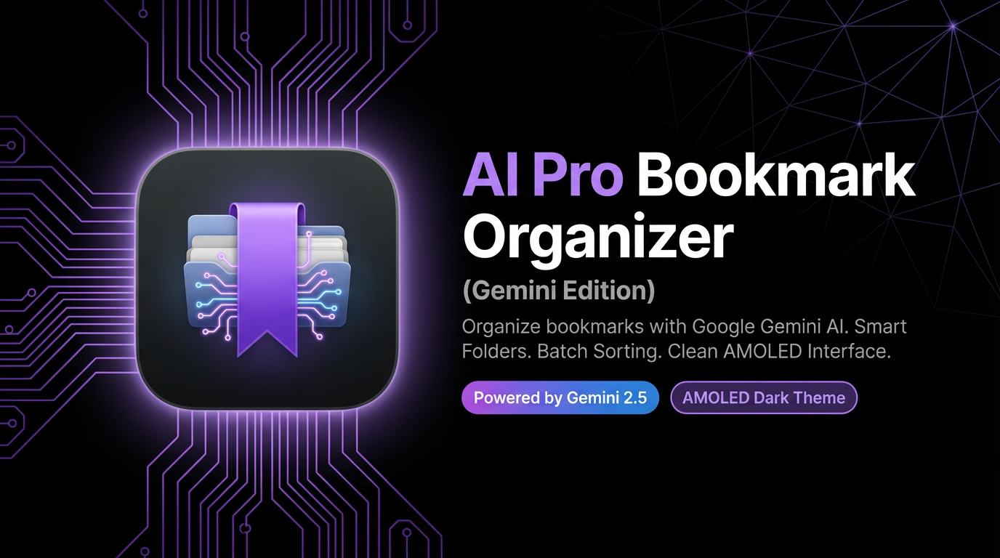
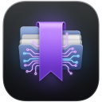

# Bookmark Helper (Gemini Bookmark Manager)



A browser extension that uses Google Gemini to file, search and clean up your bookmarks. You stay in control: every AI suggestion is shown for review, and every change can be undone.



## Features

- **Save to the right folder.** Open the popup on any page, get a folder suggestion (existing or a new one) and save with one click. If the page is already bookmarked, you see where it is and can move it.
- **Auto-sort.** Bookmarks you create with the browser’s star button are moved to the best folder automatically. A notification shows where each one went, with an Undo button. You can turn this off in Settings.
- **Quick search anywhere.** Press <kbd>Ctrl</kbd>+<kbd>Shift</kbd>+<kbd>K</kbd> (<kbd>⌘</kbd>+<kbd>Shift</kbd>+<kbd>K</kbd> on Mac) on any website to open a search bar in the middle of the page. Type to find bookmarks (and, if you allow it, open tabs). When nothing matches, AI suggests related bookmarks after you pause typing. Change the shortcut at `chrome://extensions/shortcuts`.
- **Search.** The same search in the popup and the full-page manager: instant, ranked results with keyboard navigation, plus AI search by meaning.
- **Tidy up a folder.** AI proposes moves for a whole folder or a selection. Moves are grouped by destination; you can uncheck any or pick a different folder before applying.
- **Duplicates.** Finds exact duplicates (ignoring http/https, `www`, trailing slashes and tracking parameters), similar URLs and sites with many bookmarks. Keep one copy in a click, or let AI decide.
- **Site check.** Checks every bookmark twice: the exact saved link and its bare domain. The report shows *Page changed* (the site responds but the page doesn't, or it redirects home) apart from *Site down* (nothing responds), with a status for each: Alive, Not found · 404, Timed out, No response or Not checked. Open the page or the site to check it yourself, mark it as fine, delete it, or delete everything in a list at once (with undo).
- **Full-page manager.** Folder tree, multi-select (shift-click for ranges), move, delete and AI sort.
- **Right-click to save.** “Save page/link to suggested folder” from any page.
- **Themes.** Light, dark (true black) or follow the system, with six accent colors.

## Install

**[Get it from the Chrome Web Store](https://chromewebstore.google.com/detail/gemini-bookmark-manager/bncacagpbpilhncmlmlfihkpkcnpilff)**. It works in Chrome, Edge and other Chromium browsers.

## Build from source

Requirements: Node.js 22+ and pnpm.

```bash
pnpm install
pnpm build        # outputs .output/chrome-mv3
```

1. Open `chrome://extensions` (or `edge://extensions`).
2. Turn on **Developer mode**.
3. Click **Load unpacked** and select `.output/chrome-mv3`.

For development with hot reload, run `pnpm dev`. It opens a browser with the extension loaded. `pnpm zip` creates a store-ready zip in `.output/`.

## Gemini API key

1. Create a free key in [Google AI Studio](https://aistudio.google.com/app/apikey).
2. Open the extension, go to **Settings** and paste it into **API key**.
3. Click **Test** to confirm the key and model work.

Gemini 3.5 Flash-Lite is the default model: it’s fast and inexpensive, and it handles bookmark sorting well.

## Project structure

```
src/
  entrypoints/
    background.ts      auto-sort, context menu, quick search shortcut, notifications with undo
    overlay.content.ts injected on shortcut press; mounts the quick search iframe
    quick-search/      the quick search palette (runs inside that iframe)
    popup/             Save · Search · Organize · Settings (fixed 400×580)
    options/           full-page manager (organize, duplicates, site check, search, settings)
  components/          shared UI (folder picker, search, proposal review, settings)
  lib/                 bookmarks, Gemini client + prompts, duplicates, site check, search, settings, theme
public/                icons and the pre-paint theme script
```

Built with [WXT](https://wxt.dev), React, Tailwind CSS v4, Radix UI, cmdk, sonner and Lucide.

## Privacy

Your API key and settings are stored only in your browser. Bookmark titles, URLs and folder names are sent to the Google Gemini API only when an AI feature runs. Nothing is sent to any other server. Site check contacts your bookmarked sites directly, only when you run it. See [PRIVACY_POLICY.md](./PRIVACY_POLICY.md).
